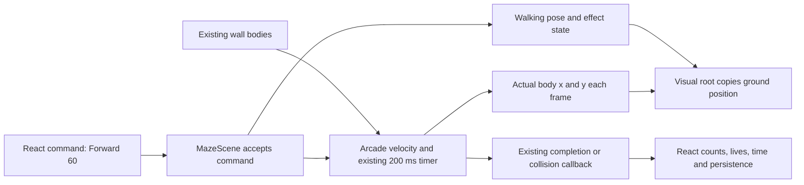

# Technical architecture

Purpose: add a complete visual system while preserving the actual movement, input and progression model in [the audit](01-current-state-audit.md). This architecture was drafted before implementation. Its proposed boundaries still guide incomplete features; implemented modules and validation status are tracked in the [entry point](README.md) and [execution plan](08-agent-execution-plan.md).

Current implementation: optional premium terrain, a Phaser-composed wall kit from the owner's `wallsNew.png`, active/claimed checkpoint badges from the supplied state sheet, static golem and exit views, a reduced-motion policy, React visual restyle, the exact supplied `player.png`, physics-post-update visual synchronization, and an optional Protractor are integrated. A guarded Phaser Light2D pilot pairs normal maps with the grass and idle player on WebGL; Canvas keeps the painted base art. Walls use their own baked depth and are rasterized once into a `RenderTexture`. Player and golem art now sort together by screen-space Y while their independent shadows remain below the actor layer; collision geometry is untouched. The earlier oblique generated walk atlas was rejected. Runtime now has a four-frame top-down walk-cycle candidate derived from the supplied player image; it is display-only and owner visual approval remains open. Multi-direction authored frames and additional character states remain future work; facing rotation follows the math state.

## Recommended technology and boundaries

Keep installed Phaser 3.90, its Arcade Physics, texture/animation managers, scene tweens and bounded particle emitters. Keep React for controls and session/navigation. Use CSS transitions for DOM polish. Library evidence and alternatives are in [research](07-library-research.md). Do not upgrade Phaser to 4 as a prerequisite: online unversioned API pages now identify a newer major version, so check APIs against installed 3.90 source.

No broad state rewrite or new entity-component framework is required. Extract visual responsibilities behind the existing `minecraftTheme.js` exports first. One scene integration owner controls `MazeScene.js`; feature authors create isolated visual modules.

Example is nominal duration, not a promise of exact 60-unit endpoint displacement; baseline stepping must be measured. No arrow returns from animation to physics.

## Proposed modules and contracts

Proposed directory `frontend/src/game/visuals/` contains:

| Module (proposed) | Contract / responsibility |
|---|---|
| `assetManifest.js` | Stable texture keys, URLs, pivots, display scales, atlas frames and fallback keys; no gameplay quantities |
| `visualTheme.js` | Palette, depth bands, quality caps and effect timings |
| `EnvironmentView.js` | Build terrain, walls and decor from existing segment arrays and visual-only level metadata; destroy resources on shutdown |
| `PlayerView.js` | `syncPose({x,y,angle,moving,won,resetting},dt)` and explicit visual lifecycle cues; own sprite/shadow/animations, never write a body |
| `GolemView.js` | Static root at supplied position; idle/directional appearance, no physics or targeting rules |
| `ExitView.js` | Base, glow and victory cue; read-only proximity; no collision body |
| `VisualEffects.js` | Bounded scene-owned particles and feedback; reduced-motion/quality policy |
| `ProtractorView.js` | Optional educational overlay at authoritative player position; angle ticks, bearing and turn annotations |

Small plain JavaScript classes/functions suffice. Do not add XState or a second animation scheduler. `minecraftTheme.js` becomes a compatibility facade; only after integration tests pass may obsolete helpers be retired in a separate scoped task. Retain existing exports while callers migrate.

## Movement and player animation

Keep `goForward` velocity, epsilon, timer, final rounding, trail endpoint, guards and callbacks unchanged. Do **not** tween body x/y, pre-move the body to a destination, ease travel speed, or interpolate the visible root behind the body. `update` or a verified post-physics render hook copies the current body center every frame; choose ordering using G00 traces. At draw time the visual ground root and body must agree within 0.5 world units. Teleports/respawns synchronize immediately. Local body bob affects a child drawing only; the shadow and ground anchor remain aligned.

Desired state priority: shutdown > victory > collision/respawn > walking > turning > settling > idle. Separate this presentation state from `hasWon/isMoving/isResetting`; it cannot extend input locks. One state transition owns each animation; cancel superseded handles instead of stacking tweens.

| State | Trigger | Visual treatment and exit rule |
|---|---|---|
| Idle | No accepted motion | 4-frame breath cycle at 3–4fps; ≤1 world-unit child bob; reduced-motion static pose |
| Preparing | Accepted forward | First 40–60ms of existing motion may show a leading pose; **no added travel delay** |
| Walking | Existing isMoving | 8-frame cycle initially 10–12fps, cadence tied to actual displacement/nominal stride; legs alternate, small arm swing and 1–2 unit body bob |
| Turning | Accepted left/right | 120–200ms visual pose blend; logical angle is immediate. Forward/another turn interrupts it immediately |
| Stopping | Normal completion | 60–100ms settle inside idle eligibility, no additional lock or translation |
| Impact | Wall collision | 3 brief frames, local lean/tint, one small puff; cancel walking, follow existing respawn/game-over timing |
| Victory | Existing exit overlap | One 6-frame celebration and local light cue; no scoring or navigation callback owned here |

At 300 units/sec, a 10-unit move lasts about 33ms and cannot show a complete gait. Display the correct partial pose and settle; never lengthen movement to finish a cycle. If body displacement is zero (e.g. against world bounds), avoid a sliding footstep effect even while a legacy timer remains active.

Facing: Phase 1 can use one approved high top-down pose with existing `90 - θ` rotation. Production directional sets can use bearings b = 0,45,…315. Choose the nearest b, then apply residual Phaser rotation `-(θ-b)` wrapped to [-22.5,22.5] to preserve the exact bearing. Do not apply `90-θ` again to a frame already authored at b. Blend/step frames without interpolation of the authoritative heading; retain a precise mathematical arrow. Use dedicated opposing-direction frames, never mirror the prosthesis. Shadow does not rotate with the cap; diffuse shading minimizes residual lighting drift.

Rotation tween may choose a short visual path, but mathematical turn annotations must preserve requested left/right direction and amount, including >180° and full turns. No command queue is added. The existing turn remains immediately accepted; rapid turns resolve to the final logical value and supersede old visual transitions.

Collision cancels visual handles immediately. On soft respawn clear tint and settle at the new root; on restart, level change, win and unmount stop scene-owned tweens/emitters and dispose listeners. Hook victory cleanup without moving the completion request to animation end. The existing timer-after-win concern is characterized in G00; changes to gameplay scheduling require a separately reviewed fix, rather than being hidden in an art task.

## Golems: behavior boundaries

Use the four existing Level 2 positions from `MazeScene.create`; Level 1 remains without enemies. Current sprites have random starting angles and no attached bodies. However, the final four tiny diagonal wall segments in `mazeDataLevel2.js` create stationary hazards at these positions, each with two 8×8 bodies. Preserve those segments, the second sprite/segment's one-unit Y offset, and ordinary wall-hit life loss. Never discard them as degenerate geometry or add a second collider to the golem drawing.

- **Required visual animation:** stationary idle compression of 1–2% over 1.6–2.4s, slight stone segment settling, low-amplitude eye light, grounded shadow. Phase offset is deterministically seeded by level and index.
- **Optional visual facing:** eyes/head turn toward player's current body position without translating or producing a danger state. If added, document it as appearance; it must not change lives, movement or collision. Prefer idle fixed facings initially to avoid implying active pursuit.
- **Deferred gameplay proposal:** patrol, moving roots/hitboxes, proximity detection, alert, pursuit or an attack system beyond existing stationary wall hazards. None of that AI exists now. No patrol/attack state may be activated in this graphics scope; preserve current collision behavior.

Heavy stepping frames may be authored as future art, but should not play as locomotion while the game keeps the golem stationary. Optional idle foot shift can emit at most one small dust puff occasionally; keep it quieter than player actions.

## Exit and other effects

First record exit AABB in themed and fallback modes. Create a separate hidden zone with the **same center and measured dimensions**, and attach the existing overlap callback to it. Initially preserve 64×64 themed and 40×40 fallback behavior; any unification requires a separate gameplay decision. The view may use a transparent 128px frame scaled into the agreed display footprint; scaling glow must never resize the zone.

Base plate is stable. A separate amber halo now pulses softly behind the plate. A low-opacity proximity ring increases within 110 world units through a read-only distance check; this is visual feedback only and adds no activation condition. A masked highlight may sweep once per 6–10s. Victory may briefly energize the ring and emit ≤24 particles, while the existing overlap/save/navigation sequence remains authoritative. Reduced motion keeps a steady plate/proximity cue, with no pulse, sweep, burst or shake.

Use baked soft shadow/glow sprites first. Phaser WebGL glow is optional only if profiling supports it; provide equivalent Canvas appearance with sprites and alpha. Dynamic lighting/normal maps would multiply art preparation and are deferred. Avoid full-screen blur, camera pans/zooms and new camera shake. Apply reduced-motion suppression to existing crash shake through the visual policy, preserving crash timing.

## Terrain, wall geometry and deterministic decor

Grass: 512×512 standalone repeat texture with explicit tile scale; rebuild seams before use. Phaser 3.90 TileSprite rescales non-power-of-two source into a power-of-two backing canvas (verified source), so prefer POT textures for repeats. Do not place repeated textures into trimmed atlas frames. Retain fixed world coordinates and use broad baked color variation; no wind shader initially.

Walls: replace dense independent stamps with modular strips plus caps and computed joins, composed once per level into a RenderTexture if profiling supports it. Keep a direct-sprite Canvas fallback. For each immutable segment A→B calculate length L and screen rotation `atan2(dy,dx)`. Repeat the wood strip at uniform scale along L; clip the last repeat, never stretch its grain to the entire length. End caps cover clipping and depict end grain. Short segments use clipped/reduced cap pieces rather than overlapping large caps.

Build a **render-only** endpoint/intersection graph with tolerance ≤0.25 world units; it must not rewrite maze data. Split render spans at crossings/T junctions; use shared posts/caps or beveled join polygons. Limit long miters at acute angles; use a bevel/post instead. Support arbitrary diagonal angles, reversed endpoints and collinear overlaps. Render shadows separately with one consistent world light, not rotated baked shadows inside strips.

Structural contact outline must trace the actual existing body union, including diagonal stepping/end overhang. The richer upper face/fascia may overhang, but soften/fade its overlap near the hero rather than hiding a valid route. Never use this new mesh as collision geometry. Nine-slice works for rectangular UI panels, not arbitrary-angle wall networks; tilemaps would quantize the current segment geometry and are rejected for the initial redesign.

Boundary rendering uses the same timber kit with existing perimeter collision segments. There are no gameplay dirt paths; any path scuff is decorative only and cannot imply a new route or traversal cost.

Proposed visual-only decor metadata belongs in `visuals/levelDecor.js`: explicit positions or seeded placement, independent from `mazeData*`. Place substantial bushes/rocks/stumps only outside traversable corridors or inside already inaccessible spaces. Keep exit/checkpoint trigger areas plus a 24-unit margin free, and maintain a 48-unit clear region around start. Flowers/flat decals can appear sparsely elsewhere. No random reseeding per frame or restart; no new colliders. Avoid foliage in corridors that could obscure a traveling hero or measuring overlay; sparse props cover at most an initial 5% of walkable terrain. Validate both levels instead of assuming geometric clearance is sufficient.

Proposed depth bands: terrain -20; flat decor -15; shadows -10; trail -2; walls 0; start/exit/checkpoint bases 2; golems 4; player 5; direction cue 6; wall occlusion accents 7 only where safe; protractor tick layer 15 with transparent center; feedback/status 30. These are planned values, not current constants. Rendering order must be reviewed for hero visibility and educational overlays.

## Asset pipeline and responsive rendering

Reference sheets → approved model/material sheet → isolated transparent masters → static complete scene → animation frames → atlas/export manifest → loading checks → visual/functional gate. Art direction owns sizes and approval in [02](02-art-direction.md). Load atlases once, register animation keys idempotently across scene restarts, destroy transient objects on shutdown. Validate missing keys before applying the theme; keep fallback paths usable. Initially avoid changing the all-assets-loaded behavior except to add a diagnostic and a complete fallback set.

Painted premium assets now use LINEAR texture filtering and the Phaser config disables pixel-art position rounding/nearest sampling. Legacy texture bytes are unchanged. Compare WebGL and Canvas output at fractional CSS scales before release. Keep `Scale.NONE`, the 800×600 world and React scale computation during Phase 1. Do not turn on Phaser FIT while retaining CSS scale. Later high-DPI backing resolution must be measured against memory budgets and cannot change body coordinates. Use screen-size-aware vector text/overlay, not a larger physical game world.

### Wall and checkpoint asset integration

`visuals/WallKit.js` adds measured Phaser frames to the owner's transparent `wallsNew.png` sheet. It uses the authored horizontal/vertical pieces and rotates a clean crop of the diagonal beam into a horizontal local texture; the crop excludes neighboring elbow pixels. It independently scales beam length and 28-unit visual thickness, preventing short diagonal runs from shrinking to slivers. The renderer stamps the fixed wall artwork into one static `RenderTexture`, then places the supplied elbow at shared two-segment right-angle endpoints. Only sub-2-unit collision marker segments are omitted visually; their physics bodies are unchanged, and the existing 10-unit wall run remains drawn. The source has no dedicated T-junction sprite, so degree-three joins are not capped yet. Baked bevels/shadows replace the former separate dark shadow stroke. Wall thickness is visual and still wider than some Arcade Physics bodies, as the pre-upgrade style already was; validate close-clearance paths before release.

`assetManifest.js` loads the 282×173 checkpoint reference sheet, then `prepareCheckpointTextures` crops each badge and removes only its pale-blue panel pixels in Canvas. The badges render at 62×68 world pixels. The checkpoint overlap zones, coordinates, active checkpoint selection, and persistence are unchanged. The saving/active badge is used for unreached checkpoints at lower opacity and at full opacity for the current respawn point; the green check is used for previously claimed checkpoints.

### Light2D implementation pilot

`visuals/assetManifest.js` queues linked diffuse/normal images only when Phaser selected WebGL, enables its installed `Light2D` pipeline with a high ambient fill and one broad low-intensity warm light, and applies it only to grass, the exact player art, and the approved golem. The base-color files are not edited; generated normal maps remain provisional. The new wall kit uses its baked volume instead of Light2D; the exit keeps its existing art/feedback path. Canvas does not download normal maps and keeps the same base-color rendering. The maps need browser review because generated normal data is approximate rather than physically baked. Review the new wall and checkpoint composition before adding lights, stronger contrast, or animation.

## Integration change register

| Existing file | Proposed change | Dependency | Side effect to watch | Validation |
|---|---|---|---|---|
| `frontend/src/game/minecraftTheme.js` | Delegate loading/drawing to manifest/views; retain compatibility exports | G02 art kit | Missing keys, changed return types | Fallback/restart checks; visual diff |
| `frontend/src/game/scenes/MazeScene.js` | Attach views, synchronize roots, explicit exit zone, visual cleanup | G00 traces, G03 contract | Body bounds, event order, timer lifecycle | Functional matrix + bounds snapshots |
| `frontend/src/game/config.js` | Painted texture filtering, only after comparison | G04–G06 | Texture blur and Canvas difference | Native/phone/DPR captures |
| `frontend/src/pages/GamePage.jsx` | UI styling hooks; later Protractor state/bridge and reduced motion | G07, later G11 | Stale scene refs, double mount, input lock | Keyboard, touch, mount/unmount, count tests |
| `frontend/src/index.css` | Shared tokens, focus, touch sizes, reduced motion | Art direction | Global registration/menu regressions | Light/dark and responsive visual matrix |
| Registration/LevelMenu pages | Presentation-only class/icon adjustments as needed | G07 | Form/navigation regressions | Register/resume/replay checks |
| `mazeData.js`, `mazeDataLevel2.js`, `checkpointData.js`, context/API/backend | **No planned modification** | Regression fixtures only | Accidental gameplay changes | File diff guard + API request assertions |

Concrete task ownership, tests and effort are in [the backlog](06-development-backlog.md).
