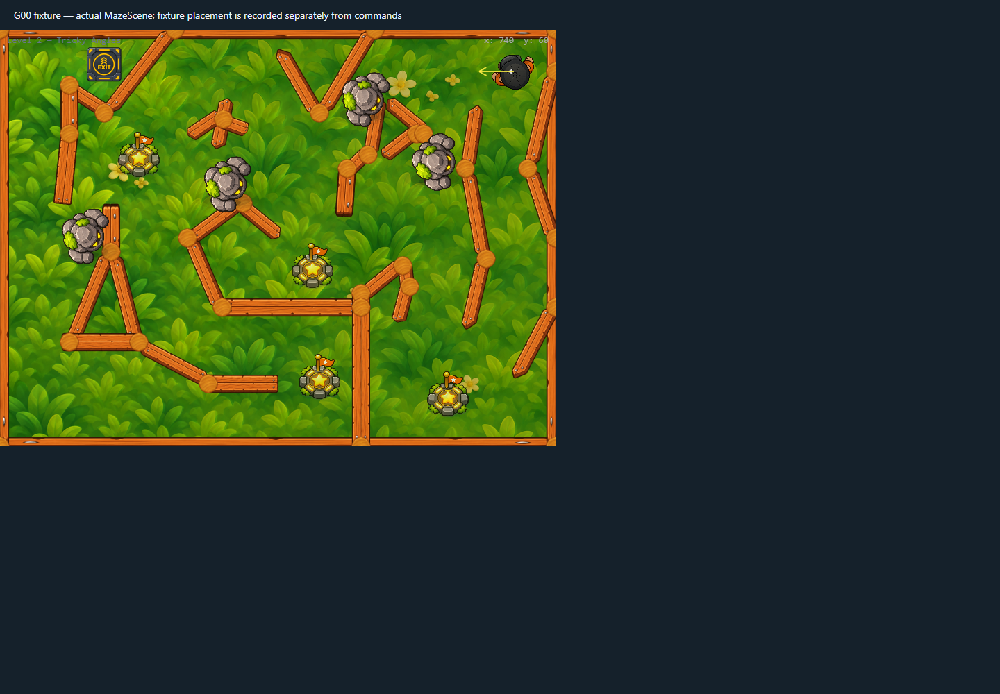

# Checkpoint source texture release v1

> Historical implementation, superseded by [checkpoint static crops v1](../checkpoint-static-crops-v1/README.md). Runtime no longer downloads, crops, or releases the presentation sheet; it loads the two optimized WebP badge assets directly.

The active and claimed checkpoint badges are cropped into separate transparent runtime textures. Once both crops are ready, the original `1774 × 887` presentation sheet is removed from Phaser's Texture Manager. The asset loader skips it on later scene starts while the two runtime badge textures remain cached.

## Memory estimate

The discarded source is about 6.0 MiB as an uncompressed RGBA texture (`1774 × 887 × 4`). The two retained cropped textures are `577 × 703` and `576 × 703`, about 3.1 MiB combined in RGBA. This avoids retaining the additional full-sheet texture alongside the badges. The source PNG still transfers once when a browser first loads the game; this change reduces decoded/runtime texture retention and restart work.

## Validation

- `level2-themed-inventory` passed in Chrome 156 / WebGL with zero browser errors.
- Both transparent badge textures remained available at their existing dimensions on initial scene creation and after a Level 2 restart.
- The source presentation texture was absent after creation and remained absent after restart.
- The Level 2 scene screenshot is unchanged in composition; no art size, position, collision, or gameplay code was adjusted.
- `npm run lint` and `npm run build` passed. Vite still reports the existing large `GamePage` chunk warning.

## Capture

The full runtime snapshot, including before/after-restart asset state, is in [`runtime-trace.json`](runtime-trace.json).
