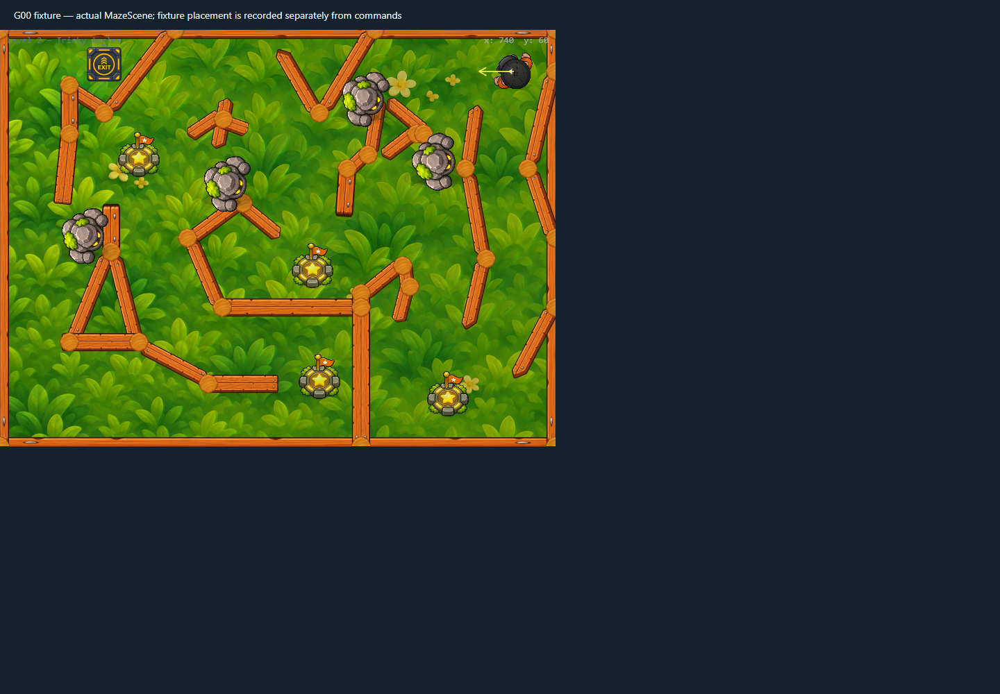
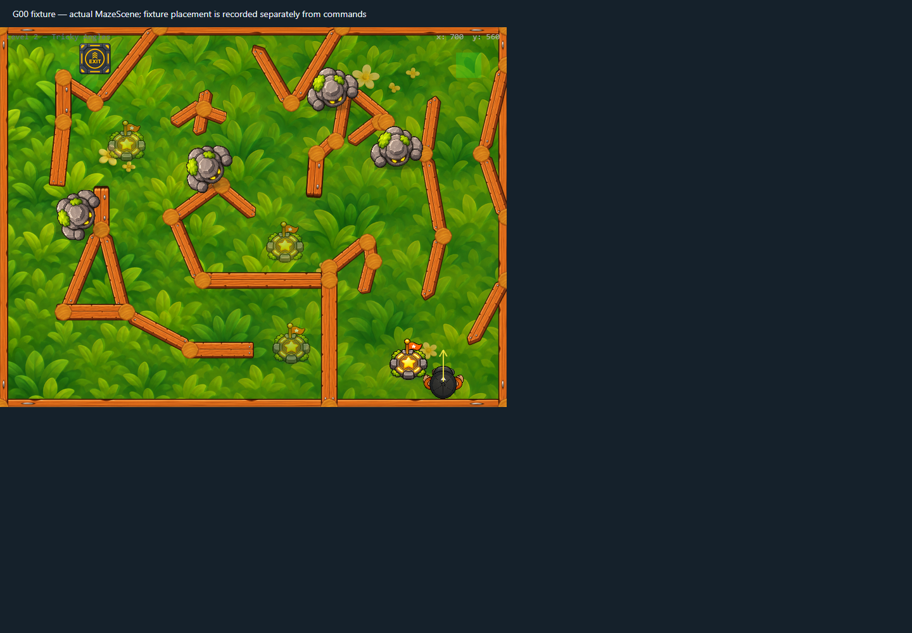
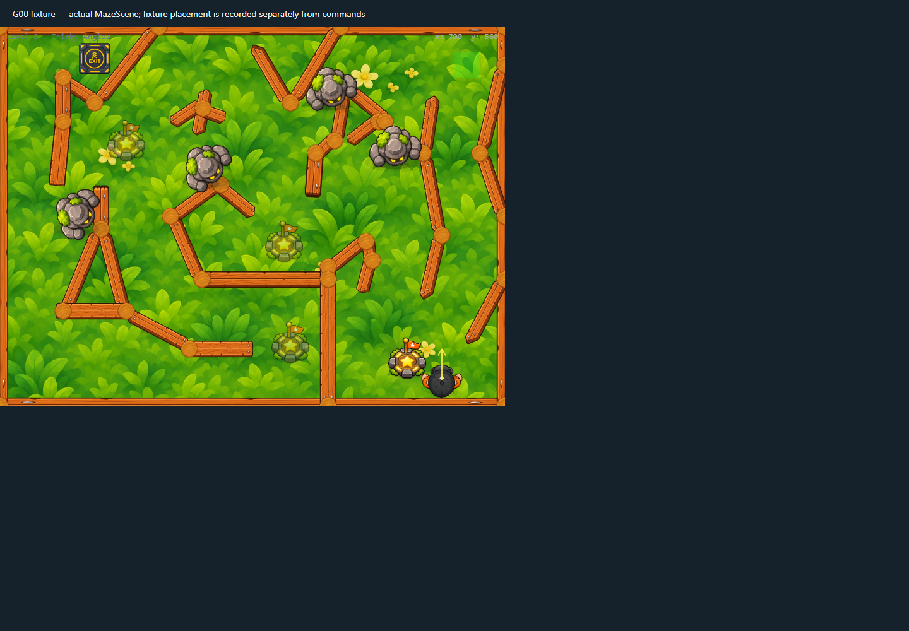
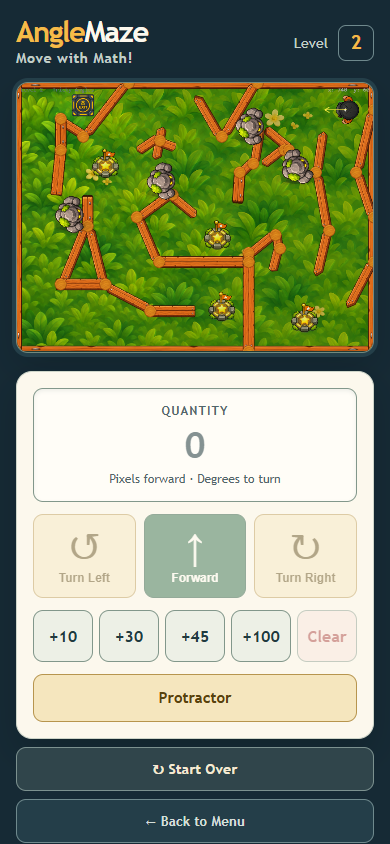

# Checkpoint static WebP crops v1

The active and claimed badges now load from separate transparent WebP assets. This replaces the earlier runtime crop path, which downloaded a presentation sheet and scanned/cropped it into Canvas textures during scene setup.

## Asset and transfer impact

| Asset | Dimensions | Size |
|---|---:|---:|
| `checkpoint-active-v3.webp` | 577 × 703 | 108,948 bytes |
| `checkpoint-claimed-v3.webp` | 576 × 703 | 108,930 bytes |
| Combined | — | 217,878 bytes |
| Previous `checkpoint-badges-v2.png` sheet | 1774 × 887 | 929,283 bytes |

The two direct assets reduce transfer size by 711,405 bytes (76.6%). The source sheet is no longer requested, decoded, or scanned at runtime. Both exports retain transparent corners and the prior crop dimensions. Existing rendered display size, checkpoint placement, overlap zones, and checkpoint behavior are unchanged.

## Validation

- `level2-themed-inventory`: both WebP files requested; prior sheet absent; both badge textures have expected dimensions and transparent top-left pixels before and after restart.
- `level2-checkpoint-overlap`: existing checkpoint overlap behavior remains intact.
- `level2-checkpoint-glow-canvas-reduced-motion`: Canvas rendering and reduced-motion behavior remain intact.
- `react-level2-phone`: mobile game route renders with no browser errors.
- All four selected Chrome scenarios completed with zero browser errors. The trace reports WebGL for the themed scene and Canvas for the reduced-motion renderer.
- `npm run lint`, `npm run build`, `node --check tests/graphics/run-baseline.mjs`, and `git diff --check` passed before this documentation-only update. Vite retains its existing large `GamePage` chunk warning.

## Captures and trace

The full browser and asset-request trace is in [`runtime-trace.json`](runtime-trace.json).

This checkpoint capture predates the grass JPEG packaging optimization; its request trace shows the original grass PNG path. The checkpoint badge assets and their validation are unaffected. See [grass PNG/JPEG review v1](../grass-png-jpeg-review-v1/README.md) for the current grass asset path and browser-validation limitation.
