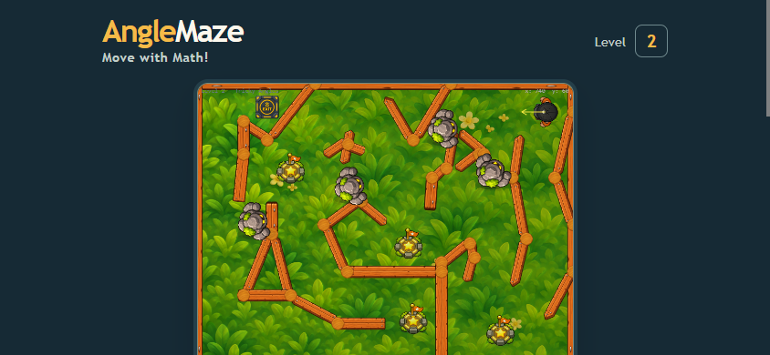

# Edge responsive viewport smoke check

The React game route passed the focused viewport scenario in Microsoft Edge 156 (`Edg/156.0.4314.58`) using headless CDP. There was one ready canvas in each viewport, no horizontal page overflow, and no browser errors. See [runtime-trace.json](runtime-trace.json).

| Emulated viewport | Canvas | Result |
| --- | ---: | --- |
| Phone portrait, 360×800 | 328×246 | Pass |
| Tablet, 768×1024 | 620×465 | Pass |
| Phone landscape, 844×390 | 413×310 | Pass |

Chrome and Edge share Chromium/Blink, so this checks browser packaging and this installed Edge version, not an independent rendering engine. The run uses software headless rendering and does not represent physical mobile GPU behavior or touch hardware.
