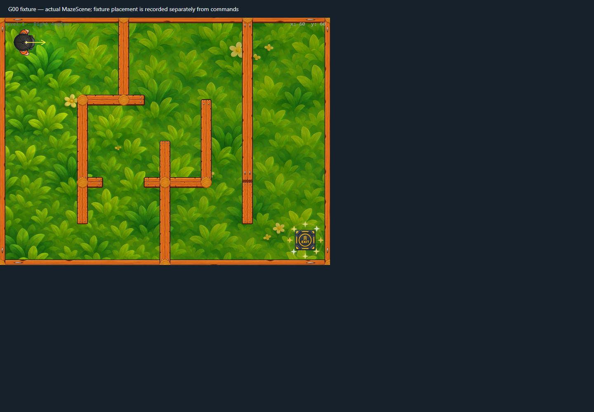

# Exit activation feedback v1

Reaching the existing exit now triggers a short amber energy ring and eight small radial sparkles around the exit image. The effect is visual-only, capped at nine temporary display objects, and completes in roughly half a second. Each object destroys itself on completion; scene teardown cancels and destroys any remaining effects.

With reduced motion enabled, exit activation retains the static highlight and creates no animated effect objects. The exit overlap, trigger dimensions, victory state, and save timing are unchanged.

## Validation

- Actual-scene Chrome checks passed for exit proximity, activation, the existing level 1 victory path, and reduced-motion preference.
- The activation added nine temporary display objects; after 650 ms the scene returned to its baseline count of 32.
- Reduced-motion activation added zero display objects.
- The captured mid-burst state showed eight visible sparkles.

This used headless Chrome/SwiftShader; a physical mobile GPU was not measured.

## Capture

