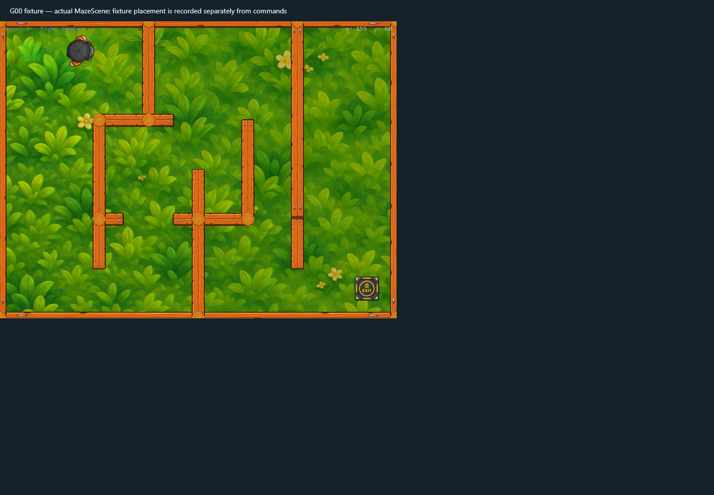
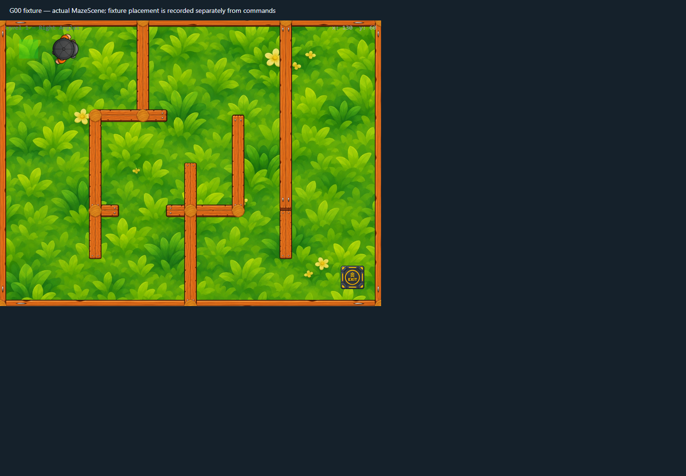
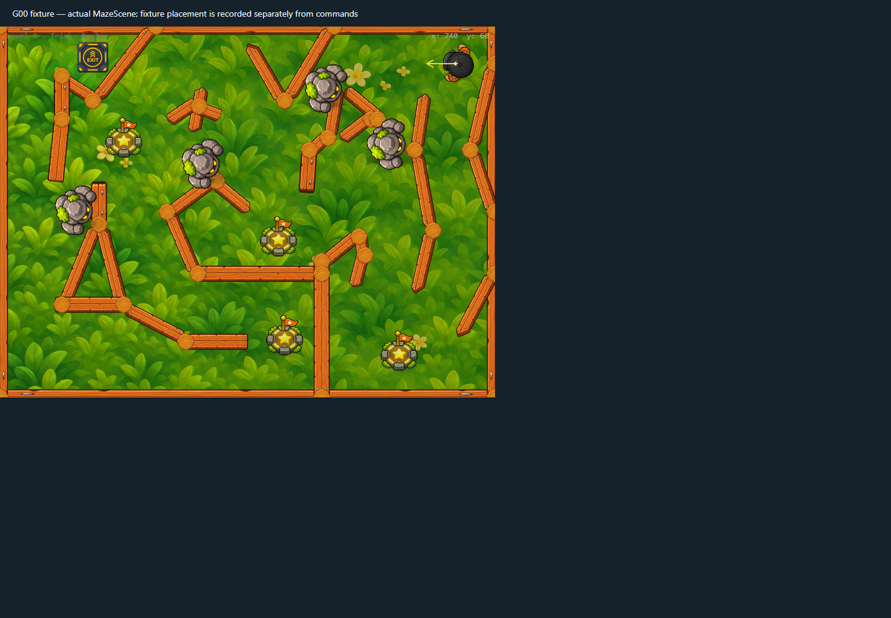
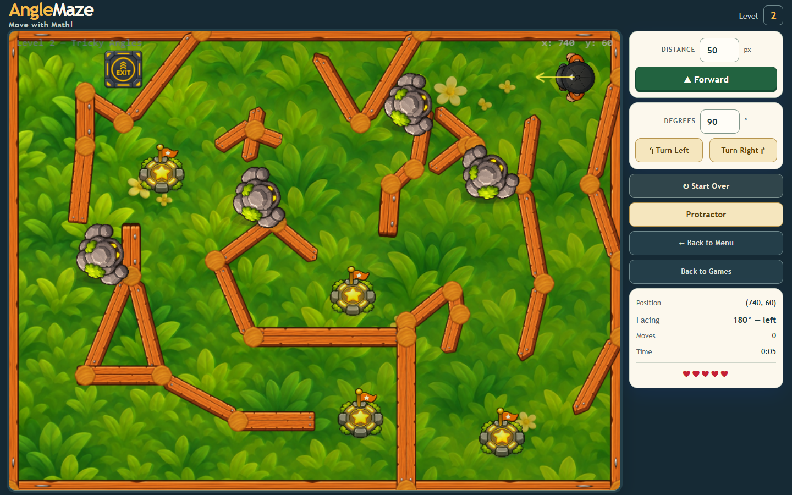
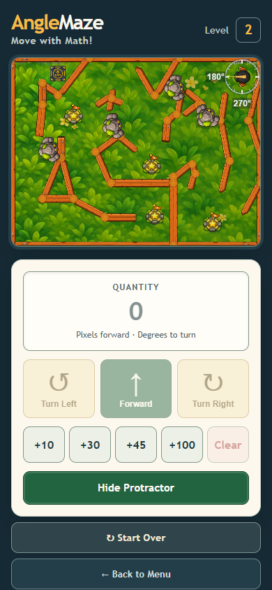

# Current focused graphics and gameplay regression

The actual Phaser scene and React game route passed all **33 scenarios** defined in `frontend/tests/graphics/run-baseline.mjs`. They ran in four isolated batches; the names were compared against the runner and all 33 passed exactly once. Chrome 157 reported zero page errors, and no external requests were allowed through the request interceptor.

Chrome's regular sandboxed renderer did not answer `Page.enable` in this workstation environment. The runner now has an opt-in `ANGLEMAZE_BROWSER_NO_SANDBOX=1` setting for its isolated headless local fixture only. The profile is temporary, the harness intercepts requests and permits only local/data/blob resources, and the environment variable is not part of production code or deployment. Filtered runs now still enable the request interceptor. The runner also handles navigation-cancelled Fetch interception IDs and makes each filtered collision/restart scenario initialize its own scene.

## Coverage

- Distance commands, turns, player walk atlas loading, orientation, settle, contact shadow, WebGL and Canvas movement.
- Wall response, golem footprint/contact, solid and swept collisions, golem facing/idle, actor depth, enemy hazard layout, checkpoint overlaps, and exit/victory effects.
- Reduced-motion behavior, 20 level restarts, the Level 1 fallback, and Level 1/2 asset-loading boundaries.
- Registration/instructions, desktop and phone game routes, responsive viewports, resized controls, and Protractor alignment/toggle/turn/restart.
- Idle Level 2 observation: 60 seconds / 3,601 frames, p50 16.7 ms, p95 17.1 ms, p99 17.4 ms, zero stalls above 50 ms.
- Active Level 2 observation: 8 seconds, 24 moves and 23 turns, p95 17.1 ms, zero stalls above 50 ms, five lives, no collision.
- Across 20 restarts: 430 display objects, 390 static bodies, one dynamic body, 34 textures, and five update listeners each time.

## Captures

The desktop controls after interaction are captured in [batch 2](../focused-regression-browserfix-v2/react-desktop-resized-controls-used.png); the responsive phone baseline is [here](react-phone-360x800.png).

The four `runtime-trace.json` files record the scenario results and browser configuration. The batches and additional screenshots are in [batch 2](../focused-regression-browserfix-v2/), [batch 3](../focused-regression-browserfix-v3/), and [the 60-second sample](../focused-regression-browserfix-v4/).

These are headless Chrome/SwiftShader measurements, not a physical GPU or mobile-device benchmark. Owner visual sign-off and physical-device review remain open.
