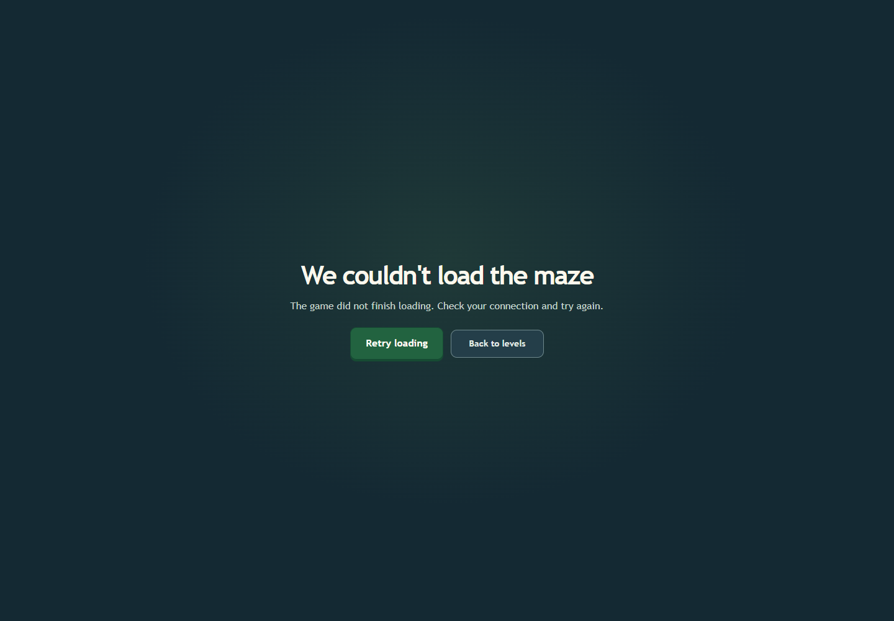
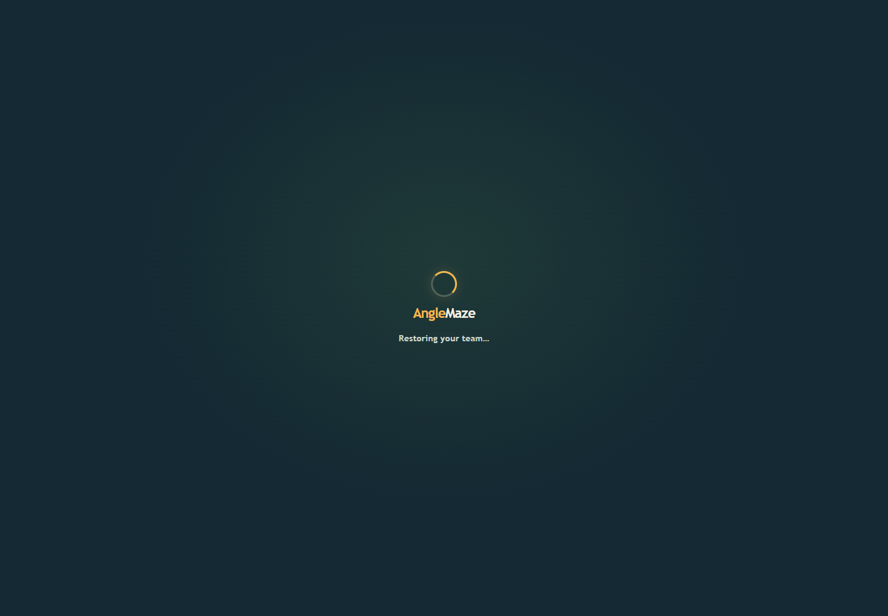
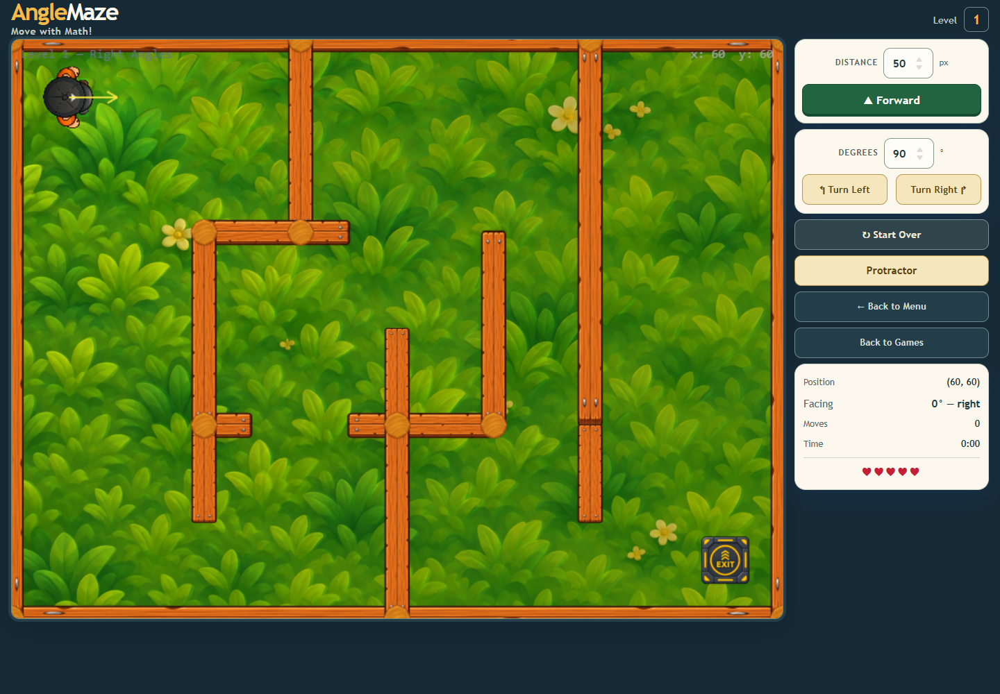
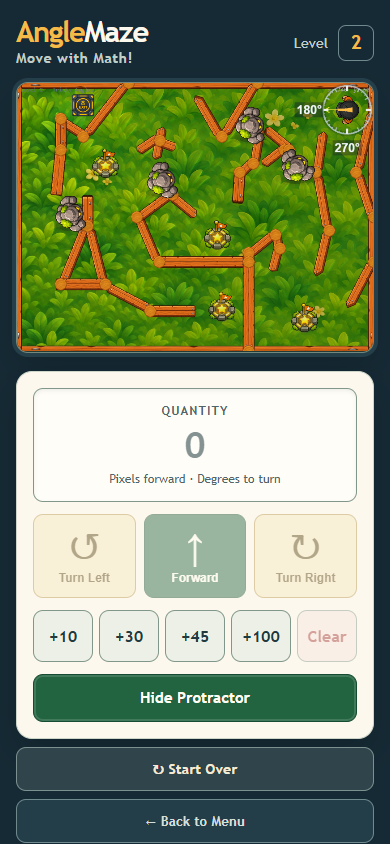

# Full browser regression with game-route recovery

All **35 scenarios** in `frontend/tests/graphics/run-baseline.mjs` passed in one isolated Chrome 157 run. The trace reports zero browser exceptions, blocked external requests, and fetch interception errors. In addition to the previous renderer, movement, collision, effects, responsive and reduced-motion checks, this run blocks the lazy GamePage module, verifies the accessible error state, retries, and confirms the game becomes ready.

## Selected captures

Other retained captures cover the Level 2 scene, actor depth sorting, resized desktop controls, and player movement in WebGL and Canvas. Full scenario data is in [runtime-trace.json](runtime-trace.json).

## Timing and resource observations

| Sample | Result |
|---|---|
| Idle Level 2, 60 seconds | 3,597 frames; p50 16.7 ms, p95 18.3 ms, p99 19.9 ms; 1 stall above 50 ms |
| Active Level 2, 60 seconds | 3,606 frames; 178 moves and 177 turns; p95 17.9 ms, p99 18.9 ms; 0 stalls above 50 ms; 5 lives and no collision |
| 20 Level 2 restarts | Stable at 430 display objects, 390 static bodies, 1 dynamic body, 34 textures, and unchanged scene listener counts |

These measurements use headless Chrome/SwiftShader, not a physical GPU or mobile device. Firefox/WebKit, physical-device performance, and owner visual approval remain open.
