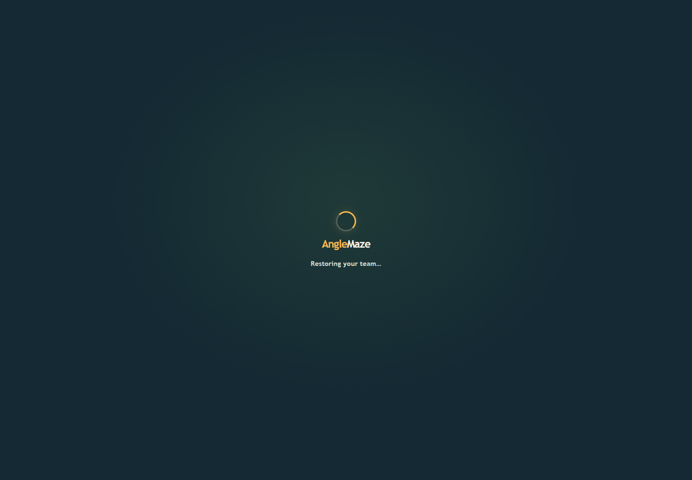
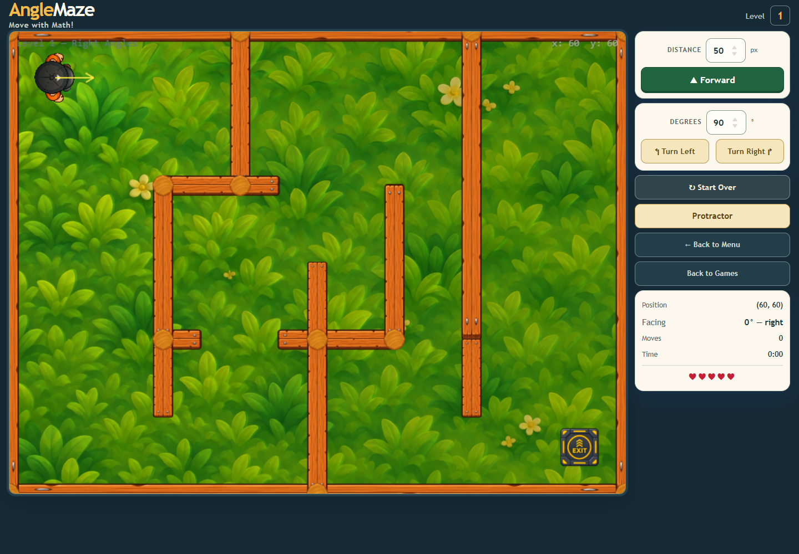
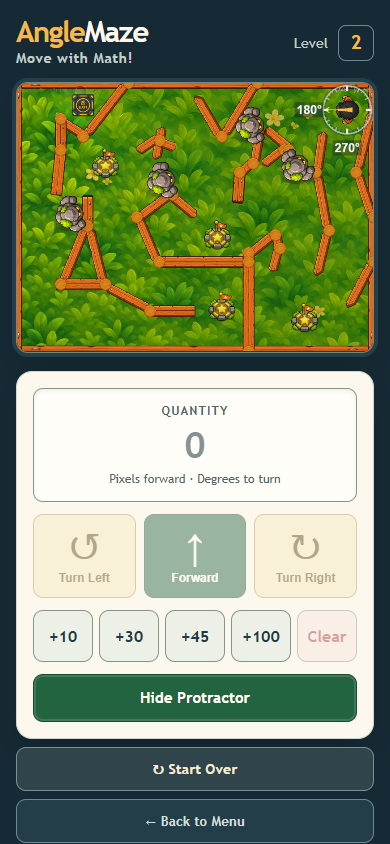

# Full browser regression after protected-route loader update

All **34 scenarios** in `frontend/tests/graphics/run-baseline.mjs` passed in one isolated Chrome 157 run. The trace reports zero browser errors, blocked external requests, and fetch interception errors. It includes the 750 ms delayed team-restoration case, reduced-motion loading behavior, and checks that the Phaser loader is hidden after the first rendered frame.

## Selected captures

The retained captures also show the phone layout, resized desktop controls, Level 2 scene, actor depth sorting, and the player walk cycle in WebGL and Canvas. The complete trace is [runtime-trace.json](runtime-trace.json).

## Timing and resource observations

| Sample | Result |
|---|---|
| Idle Level 2, 60 seconds | 3,598 frames; p50 16.7 ms, p95 17.1 ms, p99 17.5 ms; 1 stall above 50 ms |
| Active Level 2, 60 seconds | 3,608 frames; 179 moves and 178 turns; p95 17.3 ms, p99 17.9 ms; 0 stalls above 50 ms; 5 lives and no collision |
| 20 Level 2 restarts | Stable at 430 display objects, 390 static bodies, 1 dynamic body, 34 textures, and unchanged scene listener counts |

This uses headless Chrome/SwiftShader, not a physical GPU or mobile benchmark. Firefox/WebKit, physical-device performance, and owner visual approval remain open.
