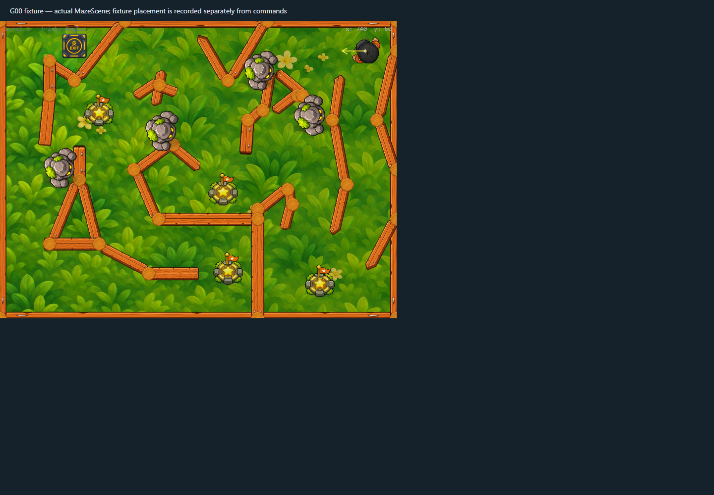
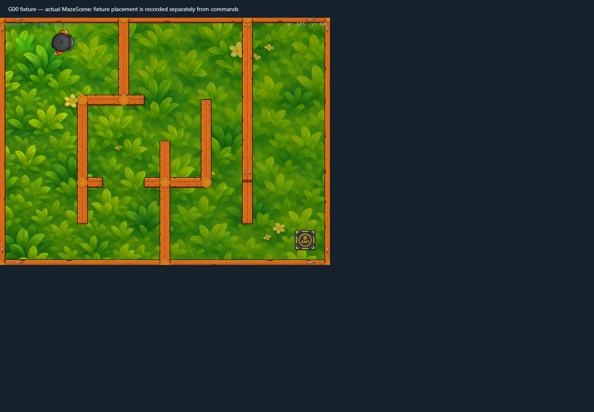
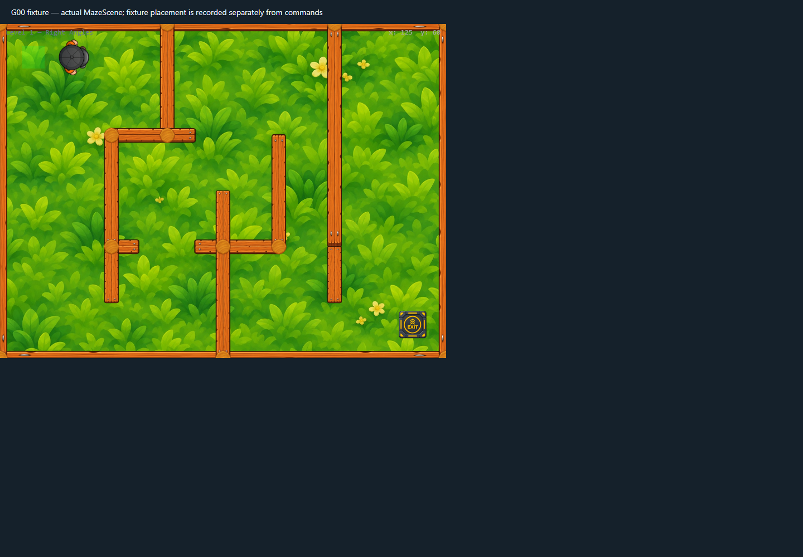
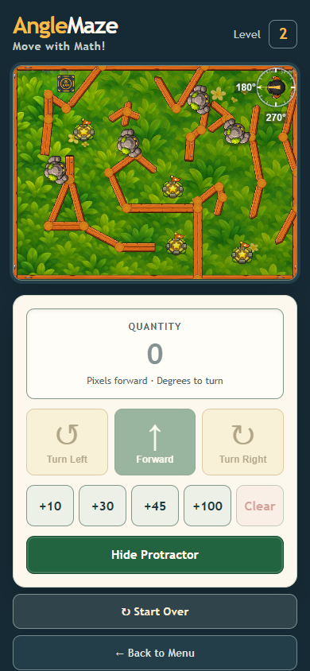

# Full browser regression after the loading-screen update

All **33 scenarios** in `frontend/tests/graphics/run-baseline.mjs` passed in one isolated Chrome 157 run. The trace has zero page errors, blocked external requests, or Fetch interception errors. This run includes the accessible route loader, reduced-motion spinner behavior, and the post-ready hidden Phaser overlay assertion.

## Selected captures

The remaining retained images show the ready desktop route, phone layout, resized desktop controls, and actor depth sorting. The complete scenario trace is [runtime-trace.json](runtime-trace.json).

## Timing and resource observations

| Sample | Result |
|---|---|
| Idle Level 2, 60 seconds | 3,598 frames; p50 16.7 ms, p95 17.1 ms, p99 17.7 ms; 1 stall above 50 ms |
| Active Level 2, 8 seconds | 486 frames; 24 moves and 23 turns; p95 17.3 ms, p99 18.4 ms |
| 20 Level 2 restarts | Stable at 430 display objects, 390 static bodies, 1 dynamic body, 34 textures, and 5 update listeners |

This uses headless Chrome/SwiftShader with the sandbox disabled only for the isolated local fixture; it is not a physical GPU or mobile benchmark. Firefox/WebKit, physical-device performance, and owner visual approval remain open.
