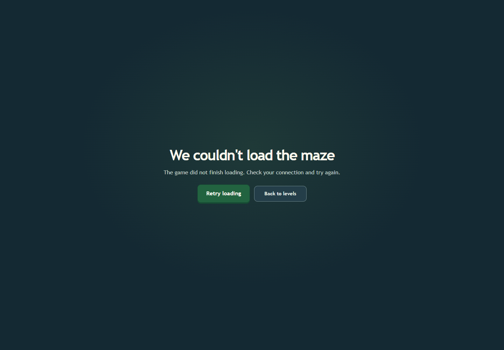
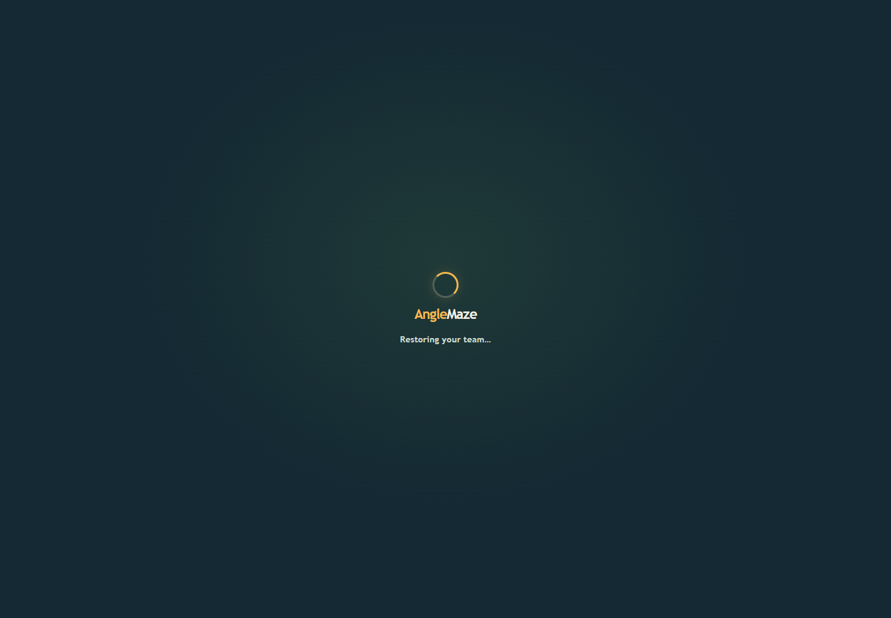
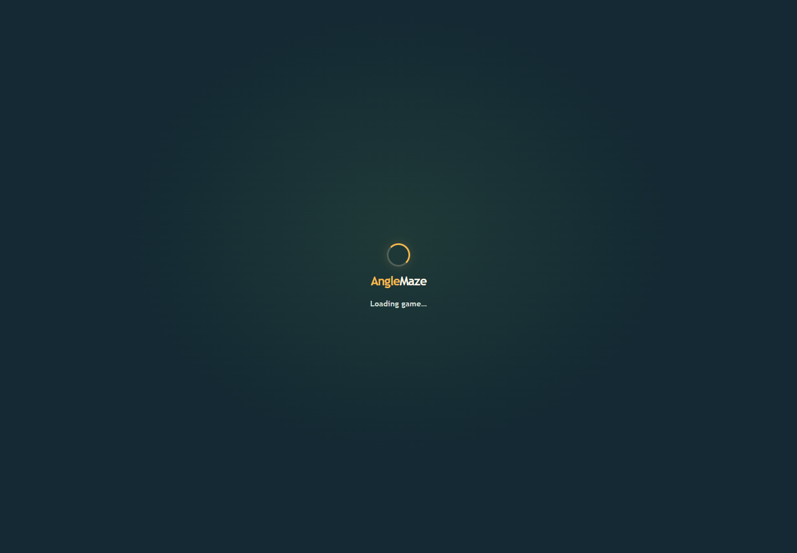
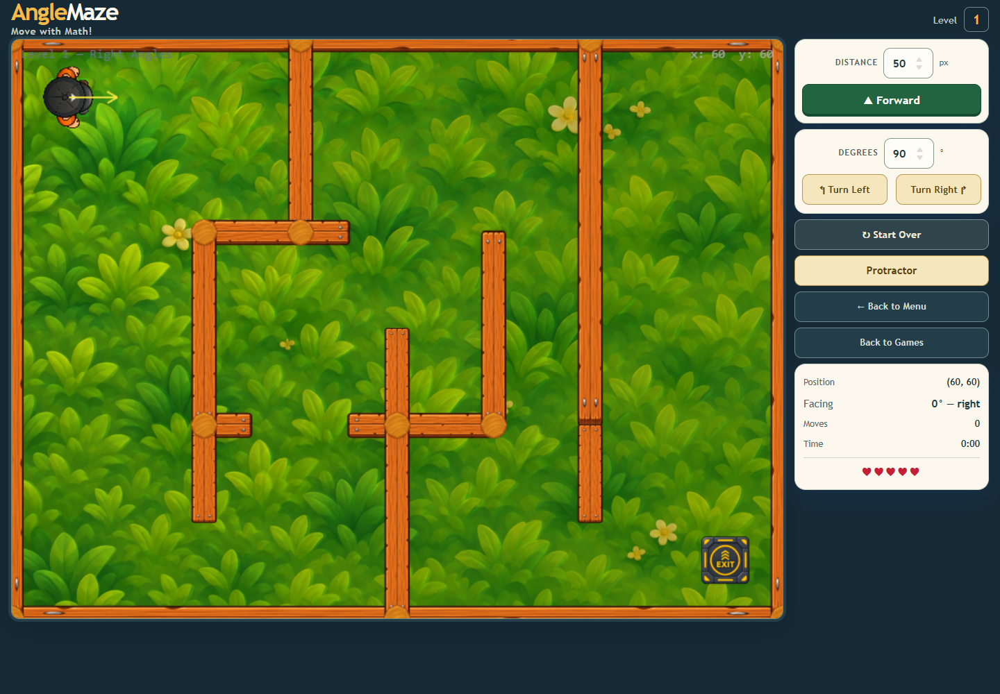
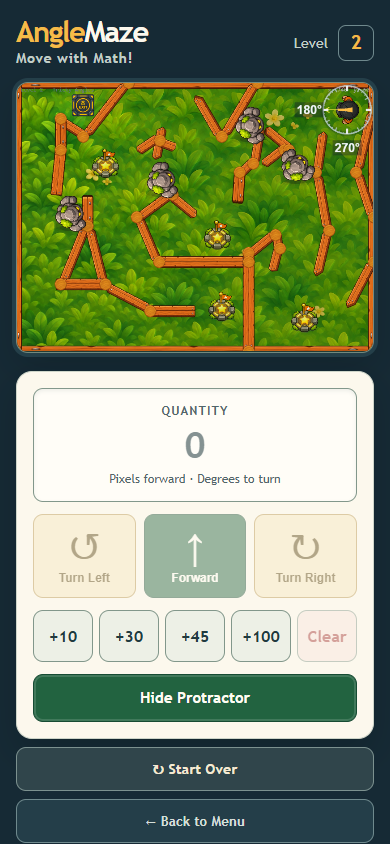

# Full browser regression after route-startup improvements

All **36 scenarios** in `frontend/tests/graphics/run-baseline.mjs` passed in one isolated Chrome 157 run. The trace reports zero browser exceptions, blocked external requests, or fetch interception errors. It includes both route error recovery and menu prefetch on keyboard focus/pointer hover, plus the existing WebGL/Canvas, movement, collision, responsive, reduced-motion, checkpoint, exit, and Protractor scenarios.

## Selected captures

Other retained images show the Level 2 scene, actor depth sorting, desktop control sizing, and player motion in WebGL and Canvas. Full scenario data is in [runtime-trace.json](runtime-trace.json).

## Timing and resource observations

| Sample | Result |
|---|---|
| Idle Level 2, 60 seconds | 3,598 frames; p50 16.7 ms, p95 17.1 ms, p99 17.5 ms; 1 stall above 50 ms |
| Active Level 2, 60 seconds | 3,609 frames; 179 moves and 178 turns; p95 17.3 ms, p99 18.0 ms; no stalls above 50 ms; 5 lives and no collision |
| 20 Level 2 restarts | Stable at 430 display objects, 390 static bodies, 1 dynamic body, 34 textures, and unchanged scene listener counts |

These measurements use headless Chrome/SwiftShader; they are not physical-device or real-GPU benchmarks. Firefox/WebKit and owner visual review remain outstanding.
