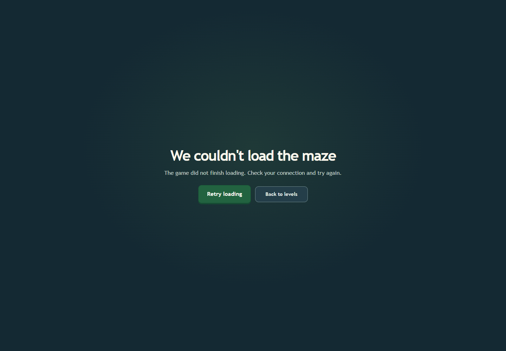

# Game route load failure and recovery v1

The lazy game route now has a React error boundary. If its module fails to load, players see an accessible branded message with two clear choices: reload the game or return to the level menu. Reloading retries the module from a fresh page context, which also recovers from stale deployment bundles.



## Validation

- Chrome 157 blocked the lazy `GamePage.jsx` request and confirmed the fallback exposes `role=alert`, a retry button, and a menu link.
- The test then removed the block, used the retry action, and verified the Phaser game reached its ready state.
- `npm run lint` passed. `npm run build` passed 18 geometry tests, Vite production compilation, and the premium asset gate (7,298,259 / 8,000,000 bytes).
- The GamePage bundle warning remains at 1,274.49 kB minified / 352.62 kB gzip. Splitting it further is deferred because a separate Phaser chunk would still be downloaded when starting a game and would not reduce total route bytes.

To repeat the focused browser check from PowerShell:

```powershell
cd C:\repos\anglemaze-platform\frontend
$env:ANGLEMAZE_BROWSER_NO_SANDBOX = '1'
$env:ANGLEMAZE_SCENARIOS = 'react-game-route-error-recovery'
$env:ANGLEMAZE_EVIDENCE_DIR = 'C:\repos\anglemaze-platform\docs\graphics-upgrade\evidence\game-route-error-recovery-v1'
node tests/graphics/run-baseline.mjs
```

The test uses an isolated headless browser and fixture API. The screenshot and full trace are stored beside this report.
