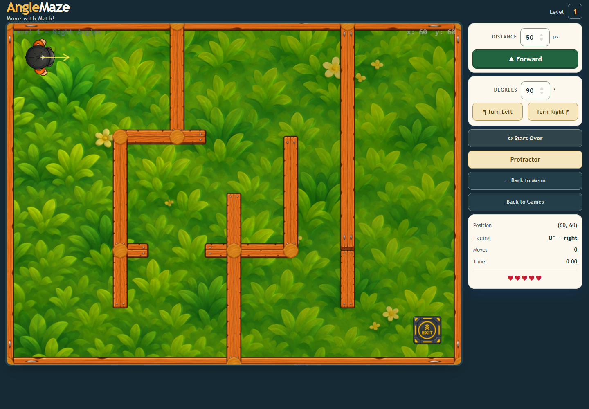
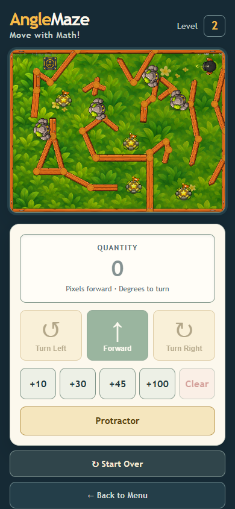

# Level-specific golem assets v1

Level 1 now defers the Stone Golem image because it contains no golem characters. Level 2 loads the image on demand; returning to Level 1 releases the golem and generated eye-glow textures after the previous scene's display objects have been destroyed.

## Expected savings

- Avoids a `1,072,916` byte golem PNG download on an initial Level 1 visit.
- The `1312 × 1199` golem image and `200 × 200` eye-glow texture represent about 6.2 MiB combined as uncompressed RGBA textures while Level 2 is active. Those textures are released when the user returns to Level 1.
- The estimate describes decoded texture storage; actual GPU allocation and browser transfer cache behavior vary by device and browser.

## Validation

- Focused actual-scene Chrome 156 run passed `level-specific-golem-assets`, `react-level1-desktop`, and `react-level2-phone` with zero browser errors.
- Initial Level 1 loaded neither golem texture nor eye glow and had zero golem sprites.
- CDP network tracing confirmed the golem PNG was not requested on initial Level 1 and was requested when switching to Level 2.
- Switching to Level 2 loaded the golem and eye-glow textures, retained four visible golems, and retained all four collision bodies.
- Returning to Level 1 released both textures and returned to zero golems and zero golem collision bodies.
- The actual React Level 1 desktop and Level 2 phone routes rendered correctly.
- `npm run lint` and `npm run build` passed. Vite's existing large `GamePage` chunk warning remains.

## Captures and trace

- 
- 
- [`runtime-trace.json`](runtime-trace.json) records the asset and collision inventory across level changes.
