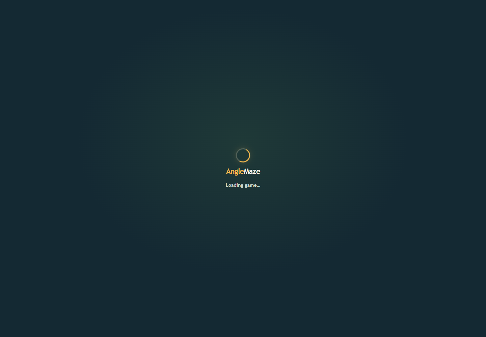
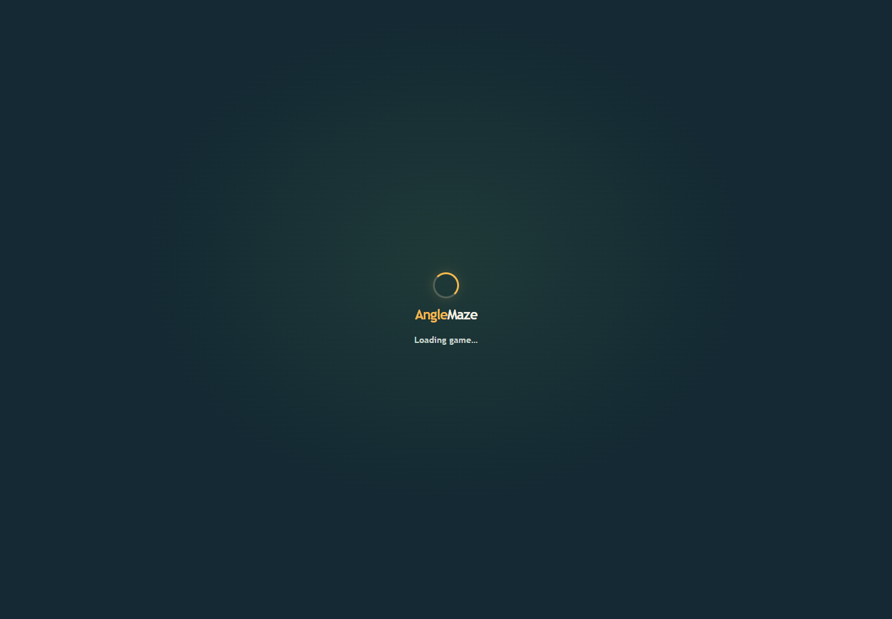

# Game route loading polish v1

The route-level lazy-load fallback, React level guard, and Phaser first-frame overlay now share the same AngleMaze loading presentation. It uses the game's navy/green palette, a small amber spinner, the wordmark, and a polite status announcement. The existing reduced-motion CSS disables the spinner animation. The scene overlay keeps its `data-game-ready` hook and becomes `display: none` with `aria-hidden="true"` after Phaser is ready.

## Validation

- Focused actual-route Chrome check passed for `react-level1-desktop`: it observed the accessible loading state in reduced-motion mode and confirmed the spinner animation was disabled, then confirmed that the Phaser canvas was ready and the scene overlay was hidden from display and assistive technology. Trace: [runtime-trace.json](runtime-trace.json).
- The ready-state page capture is [react-level1-desktop.png](react-level1-desktop.png).
- `npm test`: 18 geometry tests passed. `npm run lint` and `npm run build` passed; the asset gate reported 7,298,259 / 8,000,000 bytes.
- This focused check used headless Chrome 157. Physical-device review remains open.
