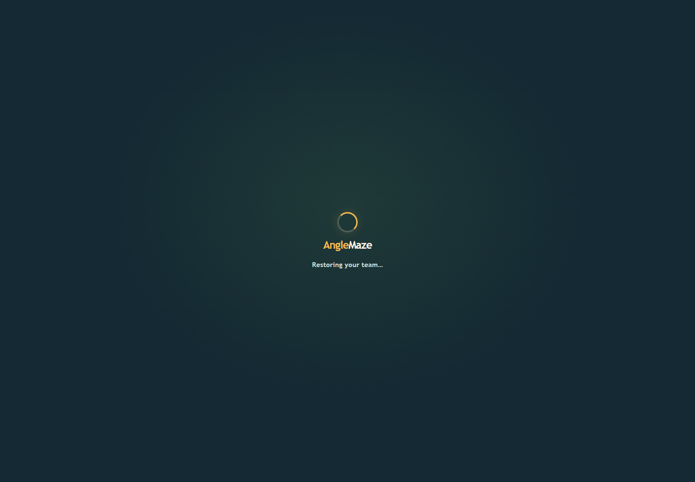

# Protected-route loading state review v2

The protected game route now uses the same branded loader while the saved team is restored. This closes the remaining startup path that previously showed unstyled monospace text. The loading component enforces its `status` role and polite live announcement, so caller attributes cannot accidentally remove those semantics.

The browser fixture delayed team and progress responses by 750 ms, captured the visible state, then confirmed hydration and the first Phaser frame completed. Under reduced motion, the spinner stays static.

## Validation

- Chrome 157 observed `AngleMaze`, `Restoring your team`, `role=status`, `aria-live=polite`, and a static spinner with reduced motion enabled.
- Team hydration completed and the game reached its ready state.
- Full 34-scenario browser regression: [report and selected captures](../full-regression-after-hydration-v1/README.md).
- `npm run lint` passed. `npm run build` passed all 18 geometry tests, Vite production compilation, and the premium asset gate (7,298,259 / 8,000,000 bytes).
- The production build still reports the known lazy GamePage chunk warning (1,274.49 kB minified, 352.62 kB gzip). This is a bundle optimization follow-up, not a failed build.

Headless Chrome with SwiftShader was used; this does not replace Firefox/WebKit, physical-device, or real-GPU review.
