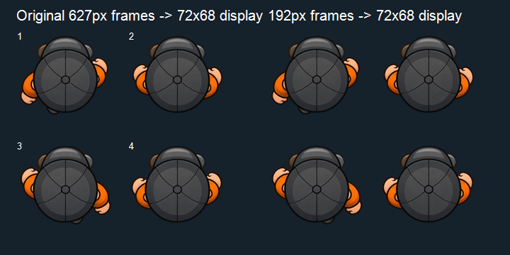

# Player walk atlas 2× review

The four existing top-down walk poses are resampled from a 1254 × 1254 atlas (627 × 627 per frame) to a transparent 384 × 384 atlas (192 × 192 per frame). Runtime displays the frames at 72 × 68 world pixels. A side-by-side image compares both versions at 144 × 136 pixels per frame, twice the displayed size; no obvious edge, silhouette, or pose loss is visible at that scale.

| Asset | Bytes | Dimensions | Frames |
|---|---:|---:|---:|
| Archived source atlas | 1,161,923 | 1254 × 1254 | 4 × 627 × 627 |
| Runtime atlas | 138,889 | 384 × 384 | 4 × 192 × 192 |

The runtime request is 88.1% smaller. Each displayed frame still has 2.67 source pixels per display pixel horizontally and 2.82 vertically. The authored frame sequence, animation cadence, player scale, physics body, movement, and idle art are unchanged. The original was copied to `docs/graphics-upgrade/source-assets/player-walk-cycle-v2-original.png` and its SHA-256 was verified before removing it from Vite's `public/` assets.

## Visual comparison

## Validation status

- Offline target-size visual comparison reviewed.
- The actual-scene regression checks the requested optimized atlas URL, 384 × 384 source dimensions, four frames, walk animation state, unchanged facing, and sprite/body alignment. Both WebGL and Canvas captures show the optimized atlas in use; see [the current focused regression](../focused-regression-browserfix-v1/README.md).
- The 33-scenario actual-scene regression passed in headless Chrome 157. Physical mobile/GPU review and owner art approval remain open.
- Original source copy SHA-256: `A150285006AFC995B137965F5B9807F7C21C94D8FFECCB50BFAA1C84E2408D4E`.
