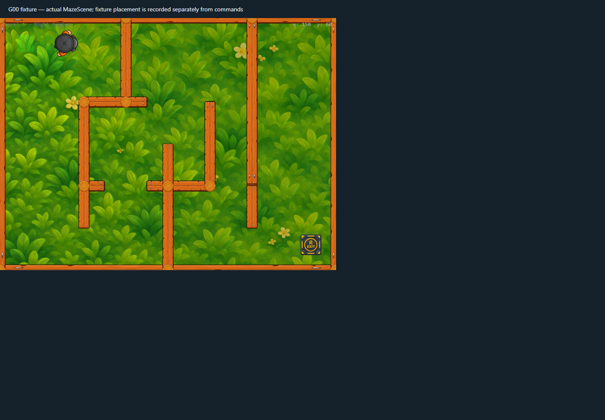

# Player walk-cycle review v2

The runtime walk atlas now uses `frontend/public/assets/premium/characters/player-walk-cycle-v2.png`. It is a transparent 1254×1254 PNG arranged as four 627×627 frames. The canonical idle image remains unchanged. The new frames emphasize alternating arm movement and preserve the overhead cap, palette, and character scale. The prior v1 atlas remains in the repository for comparison.

During movement, Phaser keeps the walk animation active but selects its frame from cumulative physics-body displacement. One full four-frame loop spans 150 world units, equivalent to the former four frames at 8 fps at the current 300 px/s speed. A restrained local squash and contact-shadow response add weight transfer. The visual root remains at the exact body position; movement, collision shapes, angles, command timing, and reduced-motion behavior are unchanged.

## Validation

- PNG transparency was checked; transparent corners are alpha 0.
- Actual-scene Chrome scenarios passed for WebGL, Canvas, and reduced-motion mode.
- The WebGL capture reported the walk texture active, unchanged facing, and zero sprite/body anchor delta.
- Production build and ESLint passed. Vite still reports its existing large game-chunk warning.

This is generated candidate art for the memorial protagonist. Owner review of the arm poses and any newly visible lower-body details remains required before treating the atlas as final art. The run used headless Chrome/SwiftShader, not a physical mobile GPU.

## Capture

