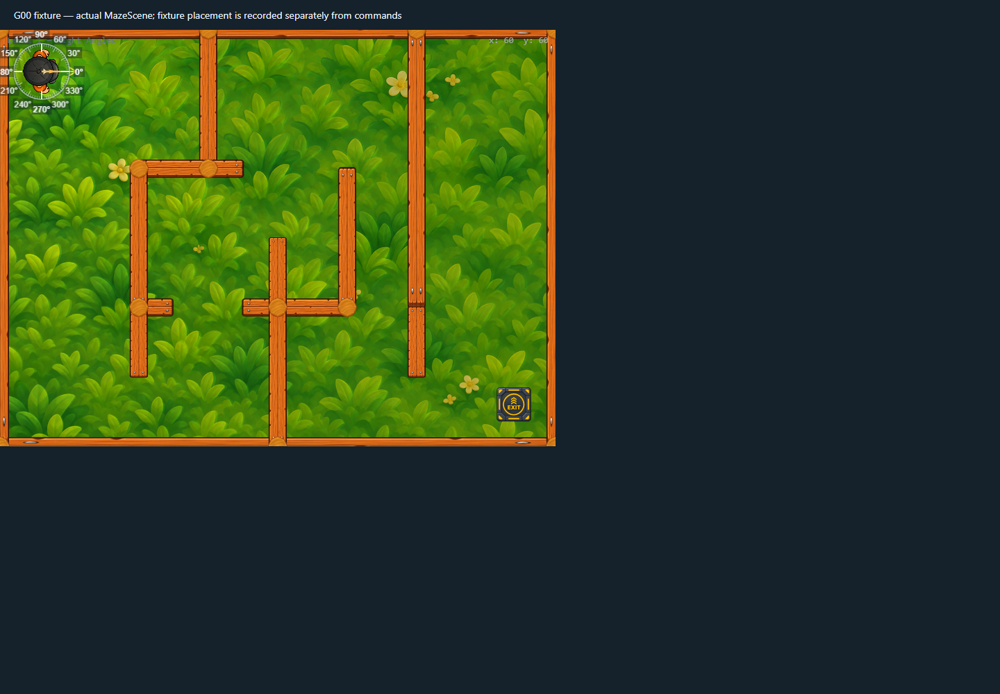

# Protractor fade review v1

The Protractor display root now fades in and out over 120ms. Visibility changes remain view-only; the ring continues to follow the actual player body and angle. Toggling during a fade reverses from the current alpha rather than restarting from a blank or fully opaque state. Reduced-motion preference cancels the tween and applies the requested visibility immediately.

## Validation

- Focused actual-scene Chrome 156 / WebGL scenario: `protractor-fade-reduced-motion` passed with no browser errors.
- Opening sampled alpha at `0`, then `0.716`, then `1`; it finished visible with no active tween.
- Closing sampled alpha at `0.402`; toggling back on completed at alpha `1` without a snap.
- Final hide completed at alpha `0` and hidden. Under emulated reduced motion, show and hide were immediate with no tween.
- Protractor root remained anchored at `(60, 60)`; player position, facing, and lives remained unchanged.
- `npm run lint` and `npm run build` passed. Vite continues to report the existing large `GamePage` chunk warning.

## Capture

The image records the settled visible state. Transition and reduced-motion samples are recorded in [`runtime-trace.json`](runtime-trace.json).

## Limitations

The check uses headless Chrome/WebGL, not a physical mobile device or GPU. It validates Phaser's overlay transition and scene preference bridge, while React's responsive control placement remains covered by the existing responsive Protractor scenarios.
