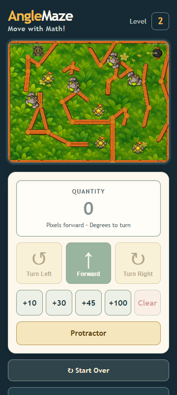
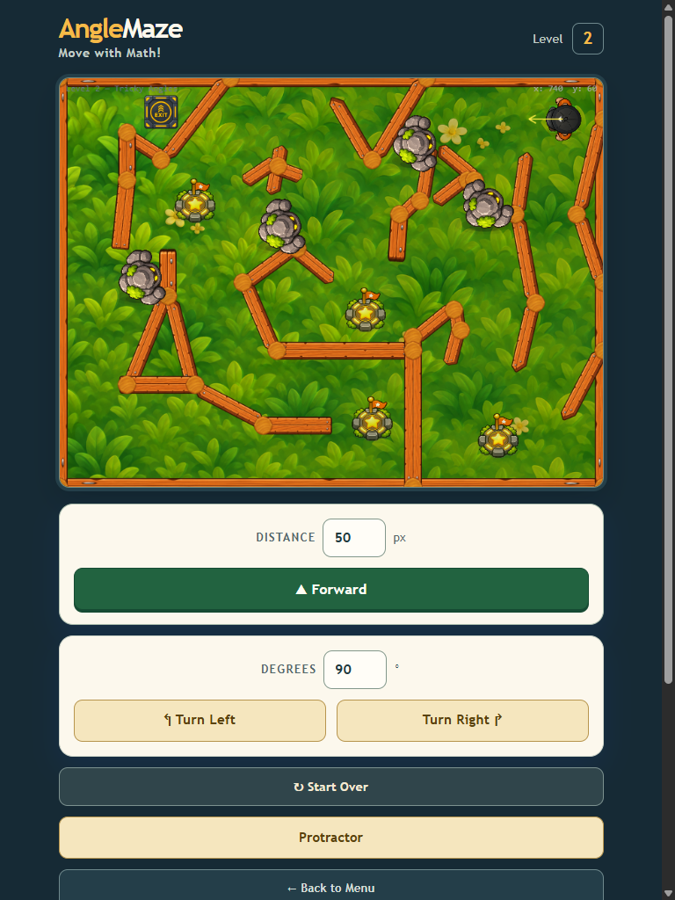
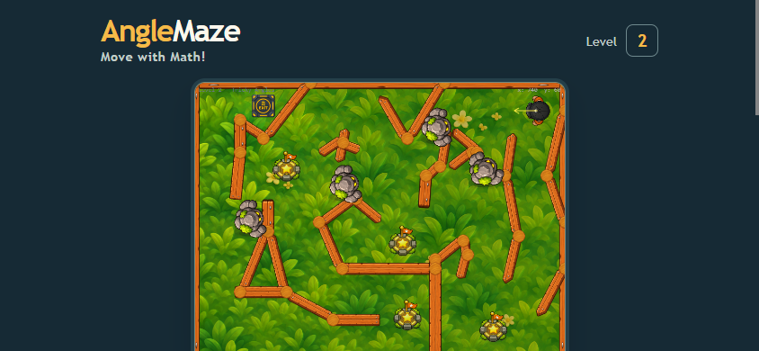

# Responsive viewport review v3

The local React game route was checked in headless Chrome with emulated 360×800 phone portrait, 768×1024 tablet, and 844×390 phone landscape viewports. See [runtime-trace.json](runtime-trace.json) and the captures below.

| Viewport | Canvas | Result |
| --- | ---: | --- |
| Phone portrait, 360×800 | 328×246 | Pass; centered and no horizontal page overflow |
| Tablet, 768×1024 | 620×465 | Pass; centered and no horizontal page overflow |
| Phone landscape, 844×390 | 413×310 | Pass; centered and no horizontal page overflow |

The landscape review exposed an unnecessarily small canvas. The previous sizing reserved 280px from viewport height even though the controls and status can continue below the canvas in the scrollable page; that capped the game at 293×220. Short landscape layouts now reserve 80px for top-level spacing, while keeping the 620px compact-width cap. The responsive sizing helper is also shared by initial layout and resize updates so the two paths stay consistent. The page remains vertically scrollable in landscape, so controls below the game may require scrolling.

The focused scenario reports one ready canvas per viewport, no horizontal overflow and no browser errors. Landscape additionally requires at least 400×300. This is browser emulation in headless Chrome, not a physical-device, touch, or mobile-GPU test. Owner visual review and physical-device validation remain open.
