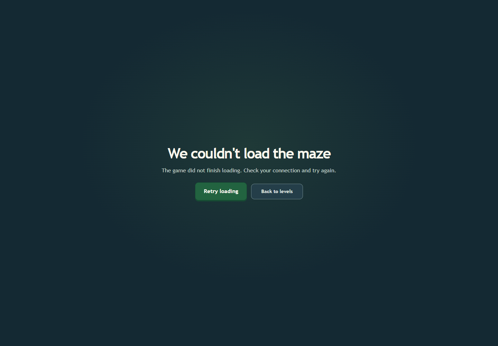

# Route startup polish v1

Two route-level improvements reduce startup friction while keeping Phaser lazy.

- Focusing or hovering an unlocked level preloads the GamePage module and Phaser in the background. It does not construct a Phaser game or canvas in the menu. Selecting the level then reaches the ready scene.
- If the lazy GamePage request fails, an accessible error boundary shows Retry and Back to levels. The retry button receives keyboard focus automatically; retrying reloads the route and recovers after the failed request is cleared.

## Validation

The focused Chrome 157 trace contains `react-game-route-error-recovery` and `react-menu-game-module-prefetch`. It confirms that the menu initially requests neither GamePage nor Phaser; keyboard focus then requests both with zero canvases; selecting the level produces the ready game. The injected failure exposed `role=alert`, focused Retry, and the menu link, and the retry reached the ready scene.

The full 36-scenario run, including both route checks, is in [the full regression report](../full-regression-after-route-startup-v1/README.md).

The prefetch shifts transfer earlier when a player signals intent. It does not reduce the GamePage's 352.62 kB gzip size; mobile users who tap immediately may see only a small overlap with the download. The production build and asset inventory still pass; the remaining bundle warning is documented in the full report.
